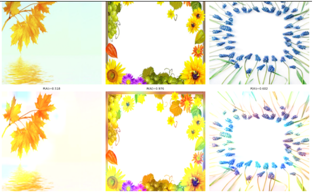
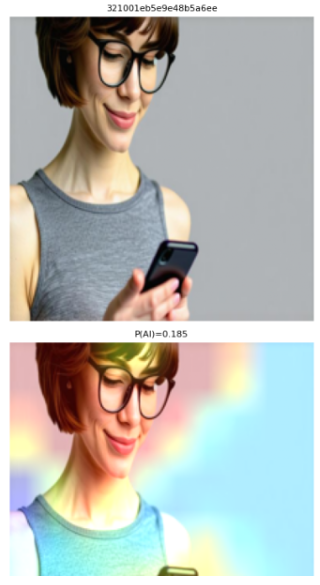

# AI Image Detector

A convolutional neural network, built from scratch in Python with TensorFlow/Keras, that classifies images as **AI-generated** or **human-made**, with **Grad-CAM** heatmaps to explain what the model looks at.

**Result: 95.0% accuracy on a held-out test set of 11,992 images.**

---

## Why

AI image generators now produce images most people can't tell apart from real photos, which makes them easy to use for misinformation. This project treats detection as a binary classification problem: given an image, is it AI-generated (1) or human-made (0)?

## Dataset

[AI vs. Human-Generated Images](https://www.kaggle.com/datasets/alessandrasala79/ai-vs-human-generated-dataset/data) (Kaggle). The human images come from Shutterstock across many categories, and each one is paired with an AI-generated counterpart.

The dataset's own test folder has no labels, so we used only the 79,950 labeled training images and split them ourselves, keeping each split balanced 50/50 between the two classes:

| Split | Images | Purpose |
| --- | ---: | --- |
| Train | 55,965 | Model training |
| Validation | 11,993 | Monitoring overfitting; choosing the best checkpoint |
| Test | 11,992 | Held out for final evaluation only |

All images are resized to 224×224 RGB, and pixel values are rescaled to [0, 1] inside the model.

## Model

A five-block CNN with about 1.0M parameters (3.83 MB):

| Layer | Output shape | Params |
| --- | --- | ---: |
| Input + Rescaling | (224, 224, 3) | 0 |
| Conv2D 32 (3×3) + MaxPool | (111, 111, 32) | 896 |
| Conv2D 64 (3×3) + MaxPool | (54, 54, 64) | 18,496 |
| Conv2D 128 (3×3) + MaxPool | (26, 26, 128) | 73,856 |
| Conv2D 256 (3×3) + MaxPool | (12, 12, 256) | 295,168 |
| Conv2D 256 (3×3) + Flatten | (10, 10, 256) | 590,080 |
| Dropout (0.5) | 25,600 | 0 |
| Dense (1, sigmoid) | 1 | 25,601 |

- **Loss:** binary cross-entropy
- **Optimizer:** RMSprop, learning rate 1e-5
- **Training:** 30 epochs, batch size 32, on an A100 GPU in Google Colab Pro (~28 s per epoch)
- **Checkpointing:** the epoch with the lowest validation loss is kept (epoch 29, val loss 0.1407)

## Results

**Test accuracy: 95.0%.** The gap between training and validation accuracy stayed around 2% or less throughout training, so dropout kept overfitting in check.

| Class | Precision | Recall | F1 | Support |
| --- | :---: | :---: | :---: | ---: |
| Human (0) | 0.97 | 0.92 | 0.94 | 5,996 |
| AI (1) | 0.92 | 0.97 | 0.95 | 5,996 |

**Confusion matrix (test set):**

| | Predicted human | Predicted AI |
| --- | ---: | ---: |
| **Actual human** | 5,510 | 486 |
| **Actual AI** | 178 | 5,818 |

## Explaining the model with Grad-CAM

Grad-CAM (Gradient-weighted Class Activation Mapping) shows which regions of an image drove a prediction. Our implementation:

1. Takes the gradient of the predicted class score with respect to the last convolutional layer, using TensorFlow's `GradientTape`.
2. Averages those gradients per channel to weight each feature map, then combines and normalizes them into a heatmap.
3. Colors the heatmap with OpenCV and overlays it on the original image.

We then ran it over the model's mistakes:

- **Heatmaps on correct predictions** concentrate on edges and fine textures. This suggests the model learned low-level generation artifacts rather than relying on what the image depicts.
- **False positives** (human images called AI) were mostly heavily edited drawings and digital graphic design, which share the smooth, artifact-like look of generated images. Missing shadows also seemed to push predictions toward AI.

  
   
  <em>False positives: human-made images the model called AI (P(AI) = 0.518, 0.976, 0.602). All three are heavily edited designs with bright, flat backgrounds and no natural shadows.</em>

- **False negatives** (AI images called human) included a portrait where the model focused on the face, and natural-looking shadows appeared to convince it the image was real.

  
   
  <em>False negative: an AI-generated image the model scored as only 18.5% likely to be AI. The Grad-CAM heatmap (bottom) shows it focused mainly on the face.</em>

## Repository contents

| File | Description |
| --- | --- |
| `project_colab.py` | Full pipeline: data loading, model, training, evaluation, and Grad-CAM error analysis (exported from Google Colab) |
| `Report.pdf` | Full project report |
| `Team2_AI_Image_Detector.pptx.pdf` | Presentation slides |

## Running it

The code was written for Google Colab with a GPU runtime.

1. Download the dataset from Kaggle and split it into `train/`, `validate/` and `test/` folders, each with `human_images/` and `ai_images/` subfolders.
2. Update `base_dir` in `project_colab.py` to point to that folder.
3. Run the script top to bottom. Training saves the best model to `AIvsHuman.keras`.

Dependencies: TensorFlow/Keras, OpenCV, scikit-learn, NumPy, Pillow, Matplotlib.

## Future work

- Fine-tune a pretrained model (ResNet50, EfficientNet or a Vision Transformer) to push accuracy higher.
- Add data augmentation (flips, rotations, brightness shifts, JPEG compression) for robustness.
- Test on images from generators the model never saw during training, to measure how well it generalizes.
- Add frequency-domain features to catch artifacts that aren't visible spatially.
- Wrap the model in a web API or browser extension.
